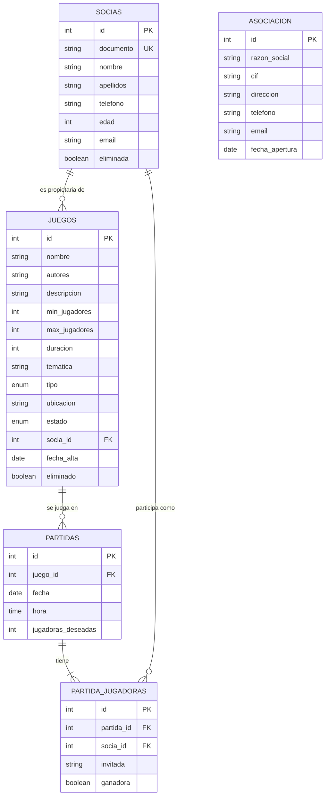

# Gestión de una asociación de juegos de mesa

Aplicación de consola en Java para gestionar una asociación de juegos de mesa de Vitoria-Gasteiz: socias, juegos, partidas y datos de la asociación. Se conecta a MariaDB mediante JDBC puro (sin ORM) y exporta los datos y los metadatos de la base de datos a XML y JSON.

## Requisitos

- Docker (para el servidor de MariaDB)
- JDK 17 o superior
- IntelliJ IDEA

Dependencias Maven (se descargan solas al abrir el proyecto):

| Librería | Uso |
|---|---|
| `org.mariadb.jdbc:mariadb-java-client` | Driver JDBC de MariaDB |
| `com.google.code.gson:gson` | Exportación a JSON |
| `com.thoughtworks.xstream:xstream` | Exportación a XML |

## Puesta en marcha

1. Arrancar el servidor de MariaDB desde la carpeta del proyecto:

   ```bash
   docker compose up -d
   ```

   El contenedor `mariadb_practica` crea la base de datos `practica` y ejecuta automáticamente los scripts de la carpeta `sql/`, que crean las tablas y cargan datos de ejemplo. Escucha en el puerto 3306.

2. Abrir el proyecto en IntelliJ. Se carga como proyecto Maven y descarga las dependencias.

3. Ejecutar la clase `org.example.Main`.

### Servidor en otra máquina

La base de datos puede estar en cualquier equipo accesible por red. Basta con arrancar allí el `docker-compose.yml` y cambiar `localhost` por la IP del servidor en la constante `URL` de `utils/DatabaseConnection.java`:

```java
private static final String URL = "jdbc:mariadb://192.168.1.50:3306/practica";
```

| Dato | Valor |
|---|---|
| Base de datos | `practica` |
| Puerto | `3306` |
| Usuario | `usuario` |
| Contraseña | `usuario` |

### Reiniciar la base de datos

Los scripts de `sql/` solo se ejecutan la primera vez que se crea la base de datos. Para borrarla y volver a crearla con los datos de ejemplo:

```bash
docker compose down -v
docker compose up -d
```

## Funcionalidades

El menú principal muestra la razón social, el CIF y la dirección de la asociación.

| Menú | Opciones |
|---|---|
| Socias | Listar, alta, modificar, baja, ver juegos de una socia, ver partidas de una socia (con día y hora) |
| Juegos | Listar, alta, modificar, baja |
| Partidas | Listar con las personas inscritas, alta, modificar, borrar, apuntarse (socia o invitada), quitar una jugadora, registrar ganadoras |
| Datos de la asociación | Ver y modificar |
| Exportar datos | Socias, juegos, partidas o todo, a XML y JSON |
| Metadatos | Ver y exportar a XML y JSON los datos de la base de datos y de sus tablas |

Los ficheros exportados se guardan en la carpeta `exportaciones/`.

## Base de datos



Decisiones de diseño:

- **`asociacion`** tiene una única fila con los datos de la asociación.
- **Socias y juegos se dan de baja de forma lógica** (`eliminada` / `eliminado`): dejan de aparecer, pero las partidas pasadas siguen apuntando a ellos, así que la integridad referencial y el historial se mantienen. Al dar de baja una socia se le quita de las partidas futuras; un juego con partidas pendientes no se puede dar de baja.
- **Las partidas se borran de forma física**, y sus jugadoras se borran solas con `ON DELETE CASCADE`.
- **`juegos.socia_id`** es `NULL` cuando el juego es de la asociación.
- **`partida_jugadoras`** guarda cada participante: una socia (`socia_id`) o una invitada (solo su nombre). Un `CHECK` obliga a que sea una cosa u otra, y un `UNIQUE` impide apuntar dos veces a la misma socia. También indica las ganadoras.
- **Las plazas libres no se guardan**: se calculan como jugadoras deseadas menos inscritas, para que nunca queden desactualizadas.

## Estructura del código

```
org.example
├── Main.java          Menús de consola y control de errores
├── models             Clases de datos (Socia, Juego, Partida, Jugadora, Asociacion, metadatos)
├── dao                Acceso a la base de datos con JDBC (un DAO por tabla)
├── services           Lógica: pide datos, los valida y usa los DAO
└── utils
    ├── DatabaseConnection   Conexión única a la base de datos
    ├── Lector               Lectura de teclado con validación
    └── Exportador           Exportación a XML (XStream) y JSON (Gson)
```

### Patrones de diseño

- **Singleton** (`DatabaseConnection`): una única conexión compartida por toda la aplicación. Si el servidor se cae y vuelve, se crea una conexión nueva automáticamente.
- **DAO** (paquete `dao`): todo el SQL está en los DAO, que convierten las filas en objetos. Los services no saben nada de SQL.

### Control de errores

- `Lector` repite la pregunta hasta recibir un valor válido (números dentro de rango, fechas, horas, textos con longitud máxima) y controla que se cierre la entrada.
- Los services validan los datos y las reglas de negocio (documento repetido, juego no disponible, partida llena…) y lanzan excepciones con mensajes para el usuario.
- Cada opción del menú se ejecuta dentro de `Main.ejecutar()`, que muestra un mensaje distinto según el error (restricción de la base de datos, conexión perdida, error de SQL, error al escribir un fichero o dato no válido) y vuelve al menú sin cerrar el programa.